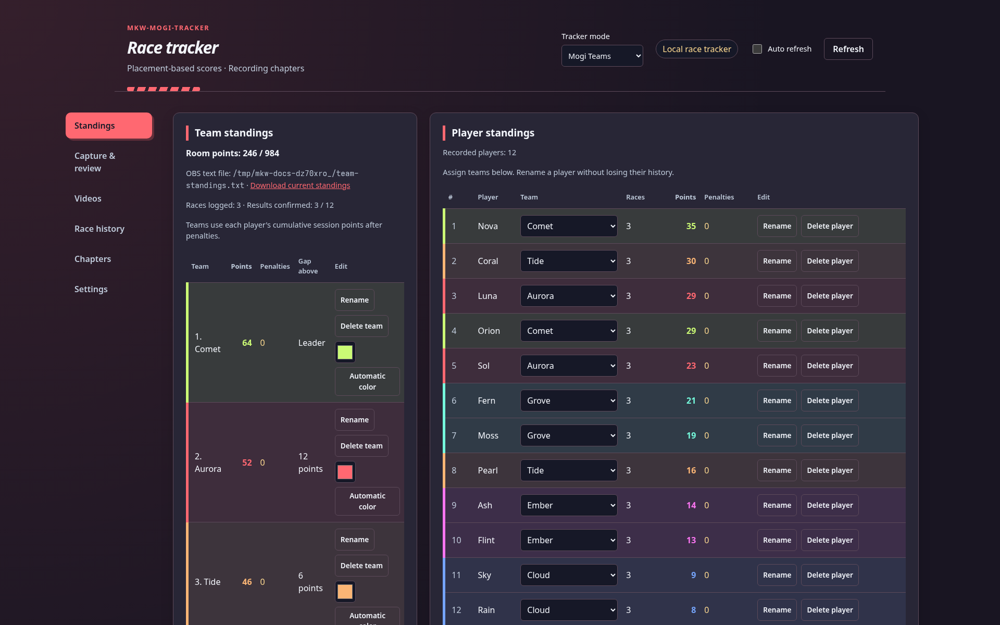
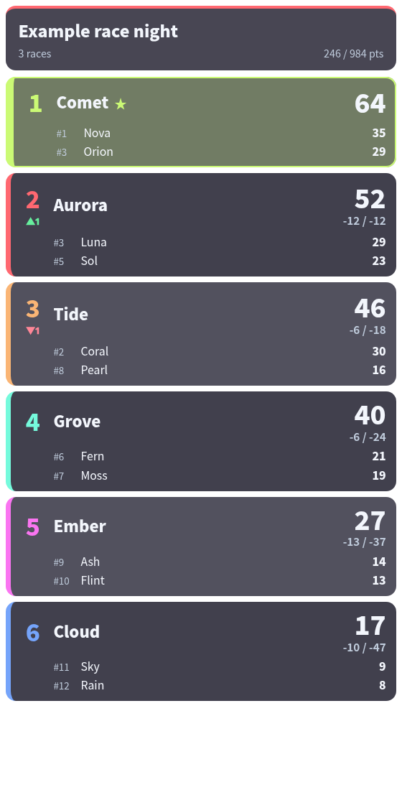

# MKW-Mogi-Tracker

**[Installation instructions and user guide](https://ebuttonsdude.github.io/mkw-mogi-tracker/)**

Also available in the [GitHub wiki](https://github.com/ebuttonsdude/mkw-mogi-tracker/wiki).

**Less scorekeeping. More racing.**

MKW-Mogi-Tracker is a **Mario Kart World scoreboard that runs on your computer**. It reads race results from OBS or a recording, helps you check them, and keeps your standings together.

- **Mogi Teams:** track twelve-player rooms and team points.
- **Mogi FFA:** track twelve players without setting up teams.
- **Worldwides:** follow your own finishing positions and VR.
- **Share:** show standings in OBS, save a results image, or export video chapter times.

You use the app in your browser. Your scores and recordings stay local. An optional external vision reader sends only name crops to your configured server after consent where required. A GPU is optional.



*Example dashboard with fictional data. By default, Mogi results count only after you check and confirm them.*

<details>
<summary><strong>Preview the OBS overlay</strong></summary>



*The OBS overlay shows post-race standings, not live positions during a race. Optional automatic visibility hides it at a detected race intro and shows it after results, with selectable transitions.*

</details>

## Getting started

**Choose your operating system below.** Run one block at a time. Each route downloads the project and opens guided setup.

<details>
<summary><strong>Arch Linux</strong> — primary tested platform</summary>

Open a terminal:

```sh
sudo pacman -S --needed git uv tesseract tesseract-data-eng noto-fonts-cjk
git clone --branch main https://github.com/ebuttonsdude/mkw-mogi-tracker.git
cd mkw-mogi-tracker
sh setupLinux.sh
sh startLinux.sh
```

Open **http://127.0.0.1:8765**. [Full Arch steps](https://ebuttonsdude.github.io/mkw-mogi-tracker/install/linux/#arch-linux)

</details>

<details>
<summary><strong>Fedora</strong> — standard DNF editions; not fully tested</summary>

Open a terminal:

```sh
sudo dnf install git uv tesseract google-noto-sans-cjk-fonts
git clone --branch main https://github.com/ebuttonsdude/mkw-mogi-tracker.git
cd mkw-mogi-tracker
sh setupLinux.sh
sh startLinux.sh
```

Open **http://127.0.0.1:8765**. Fedora Atomic editions need a different route. [Full Fedora steps](https://ebuttonsdude.github.io/mkw-mogi-tracker/install/linux/#fedora)

</details>

<details>
<summary><strong>Ubuntu</strong> — 24.04 or newer; not fully tested</summary>

Install the prerequisites and [uv](https://docs.astral.sh/uv/getting-started/installation/):

```sh
sudo apt update
sudo apt install git curl tesseract-ocr fonts-noto-cjk
curl -LsSf https://astral.sh/uv/install.sh | sh
```

Close and reopen the terminal, then:

```sh
git clone --branch main https://github.com/ebuttonsdude/mkw-mogi-tracker.git
cd mkw-mogi-tracker
sh setupLinux.sh
sh startLinux.sh
```

Open **http://127.0.0.1:8765**. [Full Ubuntu steps](https://ebuttonsdude.github.io/mkw-mogi-tracker/install/linux/#ubuntu)

</details>

<details>
<summary><strong>Native Windows</strong> — no WSL required</summary>

**[Follow the step-by-step Windows guide →](https://ebuttonsdude.github.io/mkw-mogi-tracker/install/windows/)**

1. Download the project with Git or extract its ZIP.
2. Install [uv](https://docs.astral.sh/uv/getting-started/installation/) and [Tesseract for Windows](https://github.com/UB-Mannheim/tesseract/wiki).
3. Double-click **setupWindows.bat** in the tracker folder and choose a reader. It prepares Python 3.12 and the dependencies for you.
4. When setup finishes, double-click **startWindows.bat** and open **http://127.0.0.1:8765**.

Use **startWindows.bat** every time after that. Keep its window open while using the tracker. Default Windows Tesseract folders are detected automatically; no PATH edit is needed for a default installation.

Windows 10 and Windows 11 have been tested. Windows is tested occasionally; Arch Linux is the main tested platform. Both NVFP4 readers are Linux-only.

</details>

<details>
<summary><strong>WSL on Windows</strong> — mirrored networking validated</summary>

Prefer native Windows above if you want to use Windows OBS.

In **administrator PowerShell**:

```powershell
wsl --install -d Ubuntu
```

Restart if prompted. Open **Ubuntu** from the Start menu and finish its first-run setup. In the **Ubuntu terminal**, follow the Ubuntu instructions above, keeping the project in your Linux home folder.

Start it with:

```sh
sh startLinux.sh
```

Open **http://localhost:8765** from Windows.

Enable **WSL Settings → Networking → Mirrored**, apply the change and reboot Windows before connecting Windows OBS. The maintainer validated this route with NVIDIA NF4. Follow the [WSL guide](https://ebuttonsdude.github.io/mkw-mogi-tracker/install/wsl/); NVFP4 remains unvalidated in WSL.

</details>

**Keep the terminal open while using the tracker.** Setup runs once; next time, run `sh startLinux.sh` from the project folder (or double-click **startWindows.bat** on Windows).

Already installed? Follow the [update instructions](https://ebuttonsdude.github.io/mkw-mogi-tracker/getting-started/#updating).

Want to score manually without capture? See the [minimal setup](https://ebuttonsdude.github.io/mkw-mogi-tracker/technical/installation/#guided-setup-without-prompts).

## Which reader should I choose?

A name reader helps read players from screenshots. Qwen is recommended for more accurate name reading, especially names containing symbols or Japanese characters. PaddleOCR is the lighter CPU option when your hardware cannot comfortably run Qwen. Neither replaces checking names against the screenshot. **It is optional, but highly recommended for mogi capture.** Setup lets you install, remove, or set a default reader. The **Recommended** bundle installs PaddleOCR and Q4_K_M together. **Start with Qwen3-VL-4B GGUF Q4_K_M if you want a Qwen reader:** it has broader hardware compatibility and a smaller model download than our NF4 route.

| Your computer | Recommended reader |
| --- | --- |
| Recommended Qwen starting point | **Qwen3-VL-4B GGUF Q4_K_M** — Vulkan on compatible AMD/Intel/NVIDIA GPUs, or CPU; about **3.33 GB** of model data. |
| Smallest download, CPU only | **PaddleOCR** — about 81 MB of model data. |
| NVIDIA CUDA alternative | **Qwen3-VL-4B NF4** — needs at least **6.5 GiB free**; downloads about **8.88 GB** of BF16 source weights. |
| Compatible RTX 50-series GPU on Linux | **Qwen3-VL-8B NVFP4** — needs at least **11 GiB free**. |

GGUF uses the same base 4B model as NF4, but a different quantization and runtime: **a small paired check found similar results, but broad quality parity is not established**. Vulkan needs a compatible driver; RX 6800 XT and Arc B580 are targets, not validated cards. Try recordings first, especially on CPU. If NF4 already works well for you, there is no need to switch; this recommendation is about compatibility and download size, not a proven speed or accuracy advantage.

Not every RTX 50-series card has enough memory for NVFP4. Leave space for OBS and other apps. [Download sizes and reader details](https://ebuttonsdude.github.io/mkw-mogi-tracker/recognition/)

**Accept setup’s default-reader offer, or select your installed reader in the dashboard.** Automatic does not select GGUF, NF4, INT8, or NVFP4.

**Already run a vision model on this or another trusted computer?** Configure the optional [External vision endpoint](https://ebuttonsdude.github.io/mkw-mogi-tracker/recognition/#external-vision-endpoint) under **Settings → Experimental**. No server is installed or started for you.

## Your first session

1. Choose **Mogi Teams**, **Mogi FFA**, or **Worldwides** at the top.
2. Create a new session in **Capture & review**.
3. [Connect OBS](https://ebuttonsdude.github.io/mkw-mogi-tracker/obs/), import a recording, or enter a race manually.
4. For mogi results, check all twelve names and their finishing order, then **confirm**. Partial finishing screenshots prefill only proven visible positions; unknown slots stay blank for you to complete.
5. View **Standings**. Save a PNG from **Race history**, or show the OBS overlay.

In **Race history**, use **Race order (editable)** to drag a race within its folder or choose **Move up** / **Move down**.

**Experimental YOLO mode:** Settings → Experimental can automatically confirm future Mogi results, including incomplete detections. It is off by default and requires accepting a warning. Missing players become distinct `not-detected-fixme` entries. [Read the risks and controls](https://ebuttonsdude.github.io/mkw-mogi-tracker/user-guide/#experimental-yolo-mode) before enabling it.

**Course pictures:** upload your own local thumbnails under **Settings → Course pictures**, or activate them with the migrator, including the old tracker’s coded track filenames. [Upload guidance and a suggested download prompt](https://ebuttonsdude.github.io/mkw-mogi-tracker/user-guide/#course-pictures). No course artwork is bundled.

**Choose your font:** expand **Settings → Overlay & PNG font**, preview a local font, save it for both outputs, or reset to the default. You can add your own TTF/OTF files to the data folder’s `fonts/` directory.

The **Overlays** tab holds source controls and an apply-to-preview workflow. Settings keeps themes first; font, backup and Experimental sections start collapsed. **Race history → Collapse all** closes the current mode’s session folders. WW PNG course tables use **Mean position** and **Mean VR change**, matching Standings.

[Follow the simple user guide →](https://ebuttonsdude.github.io/mkw-mogi-tracker/user-guide/)

## Diagnostic logs

Normal launches show the dashboard address and data folder, plus concise warnings and errors in the terminal. Component files record startup, connection, import and failure events at **INFO** level and above.

For extra detail, stop the tracker and launch it with **`--verbose`**:

```sh
sh startLinux.sh --verbose
```

On Windows, run `.\startWindows.bat --verbose` from PowerShell. Verbose mode adds **DEBUG** details such as HTTP response statuses, capture timings and import progress to the files, without flooding the terminal.

Logs are in **`.local/tracker/logs/`** by default, or **`<data-dir>/logs/`** when using `--data-dir`. Each entry includes a UTC timestamp, severity and component.

| File | Component |
| --- | --- |
| `app.log` | Startup, shutdown and standings-output failures |
| `http.log` | Dashboard/API listener, rejected requests and operation failures |
| `capture.log` | OBS/camera capture lifecycle, reader readiness and sample timings |
| `obs.log` | OBS WebSocket connection lifecycle and connection failures |
| `recognition.log` | Local name-reader workers and external vision readers: lifecycle, batch counts and failures |
| `imports.log` | Recording imports, progress, completion, cancellation and failures |

Each file rotates at **2 MiB**, keeping **three backups** (`.log.1`–`.log.3`): about **48 MiB** total for six components. Inactive components may have empty files. Demo logs are temporary and removed on exit.

Diagnostics omit passwords, tokens, request headers/bodies, screenshots, player names, recording paths and raw exception text. HTTP diagnostics use status codes rather than URLs. Raw model-worker stderr is discarded. Existing `.local/logs/*-ocr.log` files are not deleted; review those separately before sharing. Logs are local runtime data, excluded from Git and application packages. Review any files before sharing them; dashboard capture/import status messages remain available for more specific operation errors.

To move an existing installation, run `.venv/bin/python -m mkw_tracker.migrate "/path/to/mkw-livesplit-vos"`. The terminal menu shows category counts and size estimates, offers **select everything**, and asks for confirmation before importing. Local migration is separate from web ZIP backup limits. See the [migration guide](https://ebuttonsdude.github.io/mkw-mogi-tracker/migrator/).

## Find what you need

| Task | Guide |
| --- | --- |
| Install or start the app | [Getting started](https://ebuttonsdude.github.io/mkw-mogi-tracker/getting-started/) |
| Run a team or FFA session | [User guide](https://ebuttonsdude.github.io/mkw-mogi-tracker/user-guide/) |
| Track worldwide VR | [Worldwides](https://ebuttonsdude.github.io/mkw-mogi-tracker/ww/) |
| Capture or display standings in OBS | [OBS setup](https://ebuttonsdude.github.io/mkw-mogi-tracker/obs/) |
| Fix a problem | [Troubleshooting](https://ebuttonsdude.github.io/mkw-mogi-tracker/troubleshooting/) |
| Move from mkw-livesplit-vos | [Migration guide](https://ebuttonsdude.github.io/mkw-mogi-tracker/migrator/) |
| Protect saved sessions | [Backups](https://ebuttonsdude.github.io/mkw-mogi-tracker/data-and-backups/) |
| Install manually, build, or contribute | [Technical reference](https://ebuttonsdude.github.io/mkw-mogi-tracker/technical/) |

### About this project

No decorative game artwork is bundled; recognition rank masks are retained. Use your own permitted images for custom themes. See [third-party attribution and asset policy](ATTRIBUTION.md).

Licensed under **GNU AGPLv3 (version 3 only), with a limited NVIDIA reader
linking permission**. Commercial use, hosting and support are allowed; covered
distributed modifications and modified network services must meet the license's
source-sharing requirements. See [the license grant](COPYING.md),
[full license](LICENSE), [third-party notices](THIRD_PARTY_NOTICES.md) and
[licensing guide](https://ebuttonsdude.github.io/mkw-mogi-tracker/licensing/). Third-party software and assets retain
their own terms.

The documentation website adapts to your browser width, with character themes in the header and edge-aligned navigation on desktop.

For contributors, CI reuses a runner-local toolchain while keeping each test run isolated. Downloaded tools are never committed. See [CI cache and clean rebuilds](https://ebuttonsdude.github.io/mkw-mogi-tracker/technical/contributing/#reusable-ci-tools).

### Named OBS sources and optional Lounge cards

Overlays creates independent `/overlay/<slug>` browser sources;
`/overlay` remains backward compatible. Assign or move existing content blocks,
choose per-source display settings, and optionally show one or more manually
entered MKW Lounge usernames in Mogi Teams/FFA (never WW). Network access is off
by default. Division/MMR and season, last-ten-event and derived seven-day metrics
are individually selectable. Compact name/MMR/division badges expand into symbol-based
inline stat bubbles with short time-window labels, selectable backgrounds and borders,
recent Win % and optional last-five W/L form. There are no on-stream timestamps.
The source editor offers an available-font dropdown and estimated compact OBS dimensions. Unknown values and stale data stay clearly marked.
See [Overlay sources and compact Lounge cards](https://ebuttonsdude.github.io/mkw-mogi-tracker/overlay-profiles/) for setup,
privacy, API boundaries and official-source definitions.

### Custom Lounge card appearance

In **Overlays → Source content and Lounge cards**, use **Counter HUD style** for a glossy charcoal double-rim card, or upload your own PNG/JPEG/WebP background per source. Uploads stay local; choose **Uploaded image** and save/apply to use it. See [overlay appearance and upload limits](https://ebuttonsdude.github.io/mkw-mogi-tracker/overlay-profiles/#style-a-compact-broadcast-card).

---

<sub>Made with AI assistance from Qwen3.8-27b, Qwen3.8-Flash-Next, GPT-6.1-Sol, and GPT-6-Astra.</sub>
