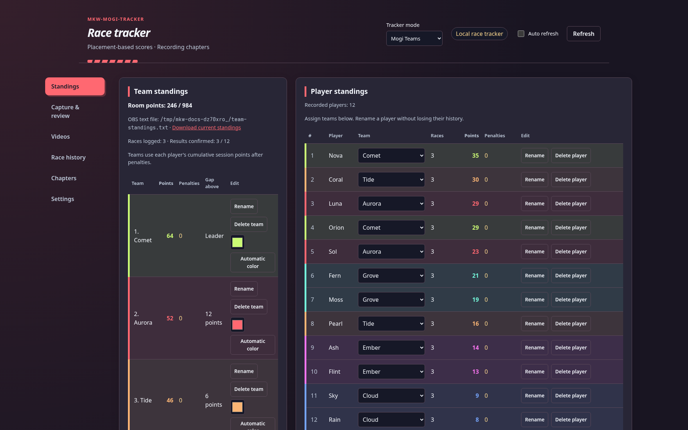

# Less scorekeeping. More racing.

MKW-Mogi-Tracker keeps track of **Mario Kart World** race results on your own computer. Use it for team mogis, free-for-all mogis, or your worldwide VR sessions.

It reads results from OBS or a recording, helps you check them, and creates standings you can share.

*Demonstration data. No gameplay or real player information is shown.*

## Start here

1. [Install the tracker](getting-started.md).
2. [Choose a name reader](recognition.md) — optional, but highly recommended for mogi capture.
3. [Run your first session](user-guide.md).
4. [Put standings in OBS](obs.md).

## What would you like to do?

| I want to… | Go here |
| --- | --- |
| Track team or FFA results | [First session](user-guide.md) |
| Track my worldwide VR | [Worldwides](ww.md) |
| Get results from a recording | [Import a video](user-guide.md#import-a-recording) |
| Save scores or video timestamps | [Share your results](user-guide.md#share-your-results) |
| Fix something | [Troubleshooting](troubleshooting.md) |
| Keep my data safe | [Backups](data-and-backups.md) |
| Develop or customize the setup | [Technical reference](technical/_index.md) |

**The website is a guide, not the app.** Install and run the tracker locally. Your scores, recordings, and OBS password do not belong on this website.
