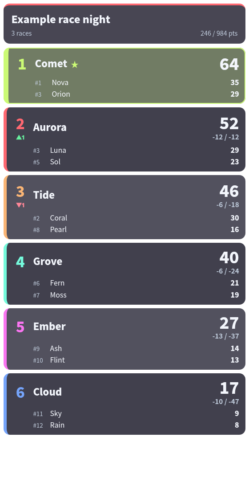

# Use OBS

OBS can do two separate jobs:

- **Send game screenshots to the tracker** so it can read results.
- **Display the tracker overlay** in your stream or recording.

You can use either or both. Run OBS and the tracker on the same computer. The WSL route has [extra networking limits](install/wsl.md).

## Read results from OBS

**Before you start:** your game should already be visible in OBS. Use an uncropped, unobstructed game source.

1. In OBS, open **Tools → WebSocket Server Settings** and enable the server. Note its port and password.
2. In the tracker, open **Capture & review**.
3. Set **Capture input** to **OBS WebSocket screenshots**.
4. Enter the exact **OBS source or scene name** that contains the game.
5. Enter the local connection URL, normally `ws://127.0.0.1:4455`, and the OBS password.
6. Under **Name recognition**, choose the [reader you installed](recognition.md#select-it-in-the-app).
7. Select **Start capture** and wait for the connected status.

**Success looks like:** capture status names the source being read. After a race, a result appears for you to review. Mogi points count only after confirmation.

OBS only needs to be open with its WebSocket server enabled. You do **not** need to be live or recording.

## Show standings in OBS

1. Start the tracker and open **Overlays**.
2. Copy **Browser source URL**. It is normally `http://127.0.0.1:8765/overlay`.
3. In OBS, add a **Browser** source and paste that URL.
4. Set its width and height to the numbers shown in Overlays.
5. Choose your overlay options in the tracker, then select **Save overlay settings**.

**Success looks like:** standings appear over your scene without a solid page background. The overlay follows the selected tracker mode and session.

The numbers update after you confirm mogi results. They are **not live positions during a race**.

Use **Show overlay**, **Hide overlay**, or **Toggle overlay** in Settings. Turn off **Enable animations** if you prefer a still display.

To automate this, enable **Automatically hide during races / show after results** and save. Live capture hides the overlay when it recognizes the course intro, then shows it when finishing results are accepted. Mogi results still need your confirmation before points count (unless you explicitly enabled YOLO). Manual controls work until the next detected event. Imports and manual score edits do not change visibility; if capture misses an intro or results, use the manual buttons.

Choose a **Show / hide effect**: bouncy slide, soft fade, checkered flag wipe, pixel dissolve, pop zoom, 3D flip, circle iris, or curtain wipe. **Transition duration** controls the speed; `0` switches instantly. Reduced-motion preferences also switch instantly. Hiding keeps the current standings and scroll position.

## Save recording timestamps

For the most reliable starting point:

1. Start the tracker and connect capture first.
2. Wait for the connected status.
3. Start recording in OBS.
4. After your session, check the course times in **Race history**.
5. Export them from **Timestamps**.

The tracker does not start or stop your OBS recording. If it cannot verify a recording time, the time stays blank. You can fill it in later.

## Keep your password private

The tracker can remember the OBS password locally. Leave the password field blank to reuse it, or choose **Forget saved password** to remove it. Do not include passwords in screenshots or support requests.

[Connection problems](troubleshooting.md#obs-will-not-connect) · [Text sources, hotkeys, cameras, and technical details](technical/obs.md)

## Separate browser sources and Lounge cards

Use **Overlays** to create named `/overlay/<slug>` URLs, assign
content blocks, and configure optional manual Lounge player cards. `/overlay`
continues to work as Default. See [Overlay sources and Lounge cards](overlay-profiles.md)
for independent settings, per-metric choices, privacy and freshness labels.
