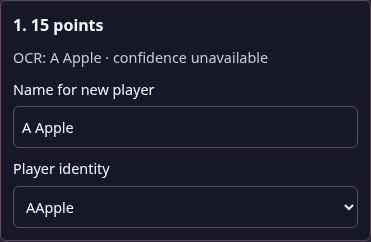
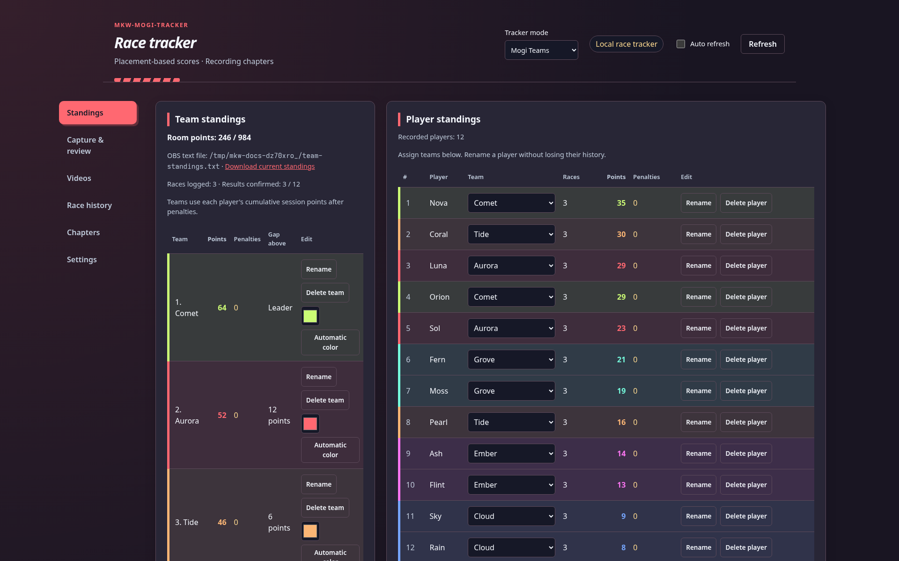

# Your first session

**Goal:** save correct results, see the standings, and share them.

Before you begin, [install and start the tracker](getting-started.md). Keep its terminal open.

## 1. Choose what you are tracking

At the top of the dashboard, select **Tracker mode**:

- **Mogi Teams:** twelve players, grouped into teams.
- **Mogi FFA:** twelve players, scored individually.
- **Worldwides (WW):** your own finishing positions and VR. Follow the [WW guide](ww.md) instead.

The modes keep separate sessions. Stop capture and finish or cancel imports/uploads before switching.

## 2. Create a session

1. Open **Capture & review**.
2. Find **Sessions** and enter a name, such as `Friday practice`.
3. Select **Create new session**.

A session is one saved event. It has its own players and results. Creating one does not erase earlier sessions.

Your new session now appears in **Race history**. You can also create a session there, or expand an earlier session and choose **Load session** to return to it.

## 3. Get your results

Choose **one** route:

- **Live game:** [Connect OBS](obs.md#read-results-from-obs), then play a race.
- **Recording:** [Import a recording](#import-a-recording).
- **By hand:** [Enter a race manually](#enter-a-race-manually).

## 4. Check and confirm each race

When a result appears in **Capture & review**:

1. Compare its screenshot with the listed finishing order. Manual result editors keep
   course evidence above the results images, with finishing results nearest the entry fields.
2. Correct any misread names.
3. Select the same existing player for each person in later races.
4. Check that all **12 different players** appear once.
5. Select **Confirm identities and count points**.

### Partial screenshots and 11-player races

If only part of the finishing table is visible, the tracker can prefill the names and **actual positions it can prove**. For example, visible positions 9–11 go into slots 9–11, not slots 1–3. Unknown slots stay blank; it does not invent a missing player.

The review shows how many positions were observed. Capture keeps looking for a fuller screenshot of that race and updates untouched fields, while preserving names you typed or cleared and identities you explicitly chose. It does not combine different screenshots to guess a complete order.

For an 11-player race after a disconnect, review the detected eleven and select the disconnected player's identity in 12th yourself. For other missing rows, check your recording or screenshots. **All twelve distinct identities still need confirmation before points count.** Partial recognition is conservative: at least three aligned ranks and finishing-phase `+points` markers must be proven, so not every partial image will produce a review.

### Example: fix a misread name

The reader proposed **A Apple**, but this is the existing player **AApple**.
In **Player identity**, select **AApple** rather than creating a second player.
The original detected text remains visible so you can check the correction.

*Fictional example, cropped from the real review form. Check every row before confirming.*

**Pending results add no points.** A screenshot is a suggestion until you confirm it. Do not use the game's cumulative scores as the finishing order.

If a player disconnected, select their existing identity for their verified finishing row. If the screenshot is incomplete, check the recording or screenshots you took rather than guessing. The tracker saves evidence, but do not rely on it as your only record. **Keep taking screenshots of every race!**

### Experimental YOLO mode

YOLO mode is **off by default**. It automatically scores future detected results in **Mogi Teams and Mogi FFA**, including video imports. Worldwides is unchanged.

1. Stop capture and finish or cancel imports.
2. Open **Settings → Experimental → YOLO mode**.
3. Read the warning: **This mode is extremely likely to make mistakes. You will likely need to edit race history, teams, and names manually.**
4. Select **Confirm - yolo** to enable, or **Cancel** to leave it disabled.

The setting is remembered across restarts and shared by both Mogi modes. A **YOLO active** badge appears while viewing Mogi. Existing pending reviews still need manual confirmation. Disable the checkbox at any time: in-flight recognition is discarded and future results require review; already scored races stay scored.

YOLO still needs evidence of a finishing-results screen and at least one verified finishing position. Detected rows keep their proven positions; missing positions or unread names become `not-detected-fixme`. Each placeholder is a separate player, including across races—identical text never joins them. Only a unique exact existing name is matched automatically. New players start unassigned; set their teams yourself.

**Race history** labels these races **YOLO auto-confirmed**, even after edits. Use the saved screenshot and your own screenshots to correct the finishing order and select the right player IDs; renaming a placeholder alone does not merge it with an existing player. Corrections replace points rather than adding another race. After a result, capture waits for a recognized course intro before automatically recording the next race; a missed intro can mean a missed race.

## 5. Check the standings

Open **Standings**.

- In **Mogi Teams**, check the teams and player assignments. The first confirmed captured roster may group names by their first character; you can rename those teams or reassign players.
- In **Mogi FFA**, each player has their own total. No team setup is needed.

Each confirmed race awards **82 points** across the room. Twelve races award **984** before penalties. These totals are useful checks, not a limit on how many races you can save.

Scores are calculated from finishing positions, not the game’s displayed points. For an **11-player race after a disconnect**, put the disconnected player in **12th place** and enter the other eleven in finishing order. You do not need to add **+3, +2, or +1** manually; the tracker applies the normal position-based scoring. All twelve player identities are still required.

## Enter a race manually

1. In **Standings**, add the twelve players. For teams, add teams and assign each player.
2. Open **Race history → Manual race entry**.
3. Enter the course. You can leave recording and intro time blank if you do not need timestamps matched to a local recording.
4. Select **Create race for review**.
5. Enter all twelve players in finishing order.
6. Select **Confirm and count points**.

## Import a recording

1. Stop live capture and wait for it to finish.
2. Open **Videos → Import video**.
3. Choose the destination session folder.
4. Enter the recording's **Local video path**, or use the file picker.
5. Select your installed reader. Leave the sample interval at **0.5 seconds** to start.
6. Select **Import video for review**.
7. Review and confirm the captured mogi results as described above.

**Local video path** reads the original without copying it. The file picker copies the recording into the tracker, so it needs extra disk space. Neither method makes recognition perfect; check for missed races.

You can cancel an import. Results already found remain available to review.

## Fix a mistake

Open **Race history** and expand the session folder. **Collapse all** closes every session in the current tracker mode, including sessions hidden by the filter. Folder expansion is remembered in this browser; collapsing does not discard an open editor’s unsaved text.

If a race was entered out of sequence, choose **Race order (editable)**. Drag its handle onto the row it should occupy, or choose **Move up** or **Move down**. The next PNG preview or download uses the saved sequence, from race 1 onward. Mogi charts and placement columns follow it; Worldwides graphs, recent-race stats and live VR changes calculated from the preceding recorded race do too. Moving a race does not edit its finishing positions, observed VR or recording timestamps.

- Use the race's result editor to correct the finishing order. Saving replaces the old score; it does not score the race twice.
- Use **Edit course / chapter** to fix a course name or timestamp.
- Use **Penalties** to deduct points from a participant without changing their finishing position.
- Use **Load session** before continuing an older event.

Avoid deleting a session just to start fresh. Create a new session instead.

## Share your results

**A picture of the standings**

Open **Race history**, expand the session, and select **View folder PNG** or **Download folder PNG**. The preview also offers **Copy image**. If copying fails, download the image instead.

**An OBS overlay**

Follow [Show standings in OBS](obs.md#show-standings-in-obs). It updates as you confirm races.

**Video chapters**

Open **Timestamps**, select the recording by its session folder name, choose a format, and click **Download Timestamps**. Check the times against the video in **Race history → Edit course / chapter**.

- **Plain text (.txt)** lists known recording-relative times and course names. Unknown times are left out.
- **DaVinci Resolve markers (.edl)** places one blue, one-frame marker per race on an **exact 60 fps, non-drop-frame timeline starting at 01:00:00:00**. All races linked to the recording need a timestamp. If the download reports an invalid time or a course name containing a pipe or line break, correct it and download again.

The displayed source rate comes from OBS video settings or the imported video's decoder when available. It does not change the EDL timeline rate. If your destination timeline is 59.94 fps or another rate, use TXT instead.

To import the EDL, open the destination timeline in Resolve. In the Media Pool, right-click that timeline and choose **Timelines > Import > Timeline Markers from EDL**.

**Your own colors or icon**

Open **Settings → Make it yours**. Choose a palette, or create a theme using an image you are entitled to use. No decorative game artwork is included. For a migrated built-in theme, expand **Create or edit a theme** and choose **Edit selected theme**. **Restore built-in** removes its imported icon and restores the original palette without changing sessions.

Settings keeps themes first, followed by overlay settings, OBS text output and transparent browser overlay information. **Overlay & PNG font**, **Session backups** and **Experimental** start collapsed. Expand Experimental to find YOLO mode and the External vision endpoint.

## Finish for the day

1. Confirm the results you want to count.
2. Stop capture or wait for your import to finish.
3. Save your PNG or chapters if wanted.
4. Press **Ctrl+C** in the tracker's terminal.

Your sessions are saved locally. Next time, start the app and load the session you want. [Back up your data](data-and-backups.md) before updates or major changes.

[Need help?](troubleshooting.md) · [Detailed controls and behavior](technical/user-guide.md)

## Choose an overlay and PNG font

In **Settings**, expand **Overlay & PNG font**. Choose a local font, try your player names in **Preview text**, then select **Save font**. It applies to both the OBS browser overlay and future PNG exports, including FFA and Worldwides. **Reset to default** restores automatic Unicode fonts.

For your own font, copy a permitted `.ttf` or `.otf` file into `fonts/` inside the [tracker data folder](data-and-backups.md), then select **Reload fonts**. Fonts stay on your computer and are not included in the app.

Characters missing from the selected font use available fallback fonts. Install a Japanese-capable font such as Noto Sans CJK for Japanese names. If no installed font has a character, it may appear as a missing-glyph box; the saved name is unchanged. The preview uses your browser, so check the PNG preview too when choosing a new font.

## Course pictures

In **Settings → Make it yours**, expand **Course pictures**. Choose one or several PNG, JPEG or WebP files. Each must be at most **4 MiB**, **4096 pixels per side** and **16 megapixels**. Saved thumbnails are resized to fit 512 × 512 pixels without changing their aspect ratio; originals stay on your computer.

The batch list matches recognizable filenames such as `Acorn Heights.png` or `MKW_Acorn_Heights_Icon.png`, plus the old tracker’s exact coded filenames such as `track_081AH.png`. Check each course association before uploading. Unknown filenames stay pending until you enter a course name; missing track numbers are never guessed. You can also associate a picture with a custom course name. Existing pictures are replaced only after confirmation, and each file reports its own result.

Saved pictures appear alongside course names in capture/review, Race history, WW course statistics and PNG reports across all three modes. Names remain visible when a picture is missing. **Delete** removes only the saved picture, not race results. The transparent OBS overlay remains unchanged.

Pictures are local runtime data in `course-images.json` inside the tracker data folder. They are not bundled with the app or included in session-backup ZIPs. The display library allows 256 pictures within 32 MiB; this does not limit how many source assets the local migrator can retain.

### Suggested prompt for downloading pictures

For an AI assistant with browsing and file-download tools, adapt this prompt and supply the course names you want:

> Find and download Mario Kart World course thumbnails from publicly accessible sources that permit me to save them for personal use. Use this exact course list: [paste course names]. Prefer PNG, or keep the original JPEG/WebP extension; do not rename another file format to PNG. Name each file after its exact course name, preserve aspect ratio, and save the files in a separate local folder. Do not guess missing course numbers or substitute courses from another game. Record each image's source link in a sources.txt file. Respect source-site terms and access restrictions. Do not alter my tracker repository, commit, publish or redistribute the images. Report any missing pictures for me to review.

Review the downloaded files and their course assignments before uploading. The tracker does not download pictures itself, and no course artwork is distributed with it.
