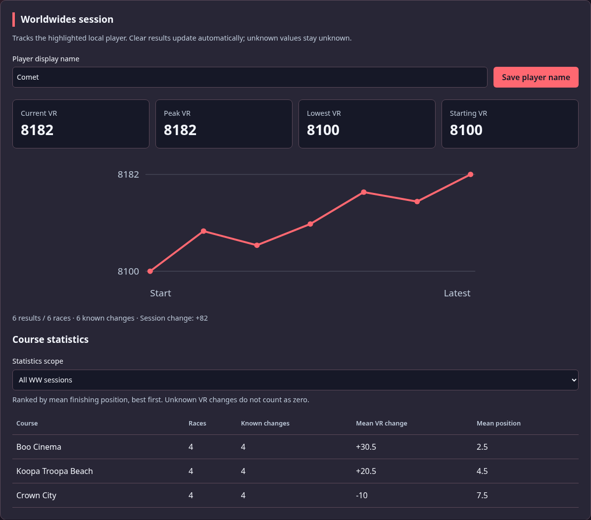
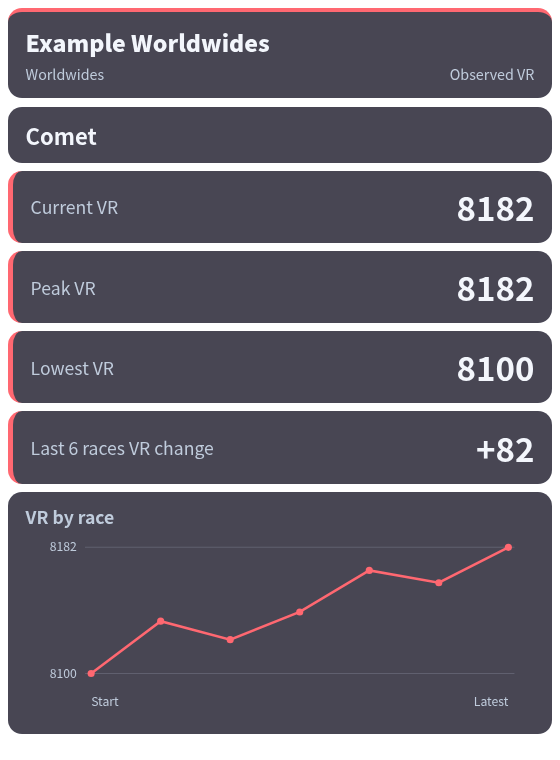

# Track Worldwides

Worldwides mode follows **your own finishing position and VR**, rather than twelve-player mogi points.

## Start a WW session

1. Start the tracker.
2. At the top, choose **Tracker mode → Worldwides (WW)**.
3. Create a new session in **Capture & review**.
4. Set your display name in **Standings**.
5. [Connect OBS](obs.md#read-results-from-obs) or [import a recording](user-guide.md#import-a-recording).

WW uses basic Tesseract reading. You do not need a player-name model for it.

## Check the results

Clear, stable WW results are saved **automatically**. Check their screenshots and correct mistakes in **Race history**.

This is different from Mogi Teams and FFA, where every result needs confirmation.

- **Live capture:** keep capture running between races. The tracker can use consecutive observed ratings to calculate changes.
- **Recordings:** cuts or missing screens may hide a VR change. The app leaves it **Unknown**, not zero.
- **Missed race:** add it manually and enter the finishing position and final VR. Leave values you do not know blank.

## See your progress

**Standings** shows your current, highest, and lowest observed VR, a graph, and course statistics.

Choose **Statistics scope → All WW sessions** to compare course results across
saved sessions. The list ranks tracks by **Mean position**, lowest
first, helping you find your statistically best track from the races you have
recorded. More races make the comparison more useful; these averages are not
adjusted for different room sizes.

*Example Standings with fictional results from two sessions.*

A gap in the graph means information is missing. It is not a claim that your VR stayed the same.

## Share your session

- Use the same [OBS overlay](obs.md#show-standings-in-obs). It switches to WW with the dashboard.
- Adjust which VR details appear under **Settings**.
- Download a session PNG from **Race history**. Its best courses use **Mean position**, lowest first, with **Mean VR change** alongside it. Unknown VR changes are excluded from that mean, not treated as zero.
- Export known recording timestamps from **Chapters**.

*Example WW overlay with fictional data. Its background remains transparent for OBS.*

WW, Mogi Teams, and Mogi FFA keep separate saved sessions. Switching mode does not convert your old results.

[Detailed WW behavior](technical/ww.md)
